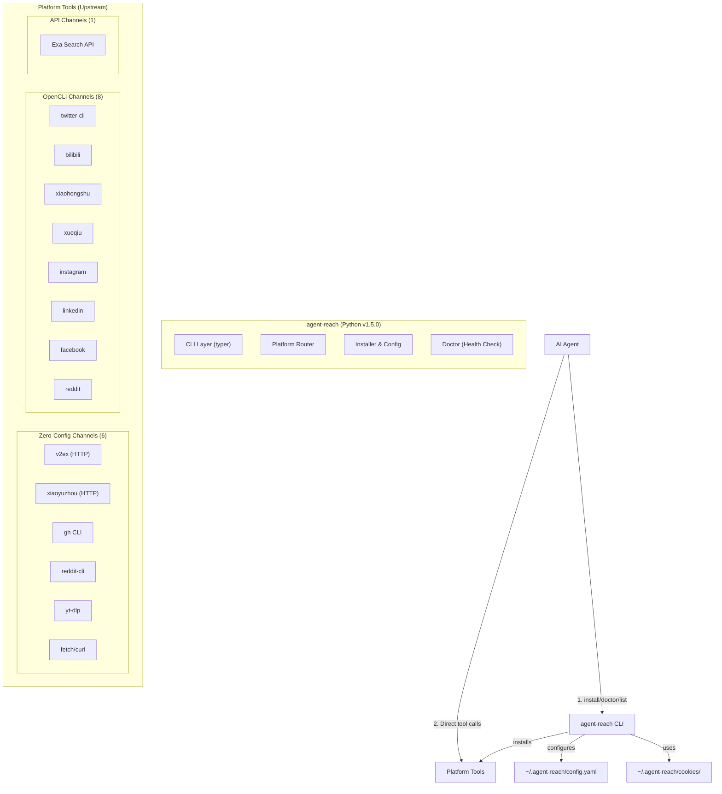
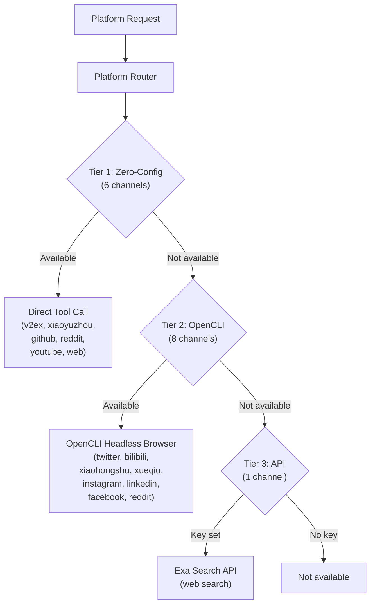

# Agent Reach アーキテクチャ

> 対象: agent-reach v1.5.0
> 調査日: 2026-07-09
> インストール先: `/Users/atosh/.local/share/uv/tools/agent-reach/lib/python3.13/site-packages/agent_reach/`

## 概要

Agent Reach は「インターネットアクセス能力のルーター（Internet Capability Router）」です。AI エージェントが15のプラットフォーム（Twitter/X、Reddit、YouTube、GitHub、Facebook、Instagram、Bilibili、Xiaohongshu、Xiaoyuzhou Podcast、LinkedIn、V2EX、Xueqiu、RSS、Web、検索）に検索、フェッチ、閲覧できるようにします。

### 設計哲学: インストーラー＆ルーター（ラッパーではない）

Agent Reach は独自のラッパーレイヤーを持たず、**上流ツールをインストール・設定し、エージェントに直接呼び出させる**方式です：

```
agent-reach install → ツールをインストール・設定
agent-reach doctor  → 利用可能性を確認
agent-reach list    → 各プラットフォームの呼び出しコマンドを表示
```

エージェントは `agent-reach` CLI 経由ではなく、表示されたコマンドを直接実行します。例：

```bash
# agent-reach list の出力
twitter:      twt search "AI agents" --limit 5
youtube:      yt-dlp --flat-playlist --dump-json "https://www.youtube.com/playlist?list=..."
github:       gh search repos "langchain" --sort stars --limit 5
```

## 全体アーキテクチャ



## 技術スタック

### コア
- **Python** (v3.13 環境, uv で管理)
- **typer** - CLI フレームワーク
- **PyYAML** - 設定ファイル解析
- **packaging** - バージョン比較

### バックエンドツール（外部依存）
| ツール | 用途 |
|--------|------|
| **OpenCLI** (`npx @opencli/cli`) | Twitter/X、Bilibili、Xiaohongshu、Xueqiu、Instagram、LinkedIn、Facebook、Reddit のヘッドレスブラウザ操作 |
| **yt-dlp** | YouTube 動画/プレイリストのメタデータとトランスクリプト |
| **twitter-cli** (`twt`) | Twitter/X の高速検索（OpenCLI がない場合のフォールバック） |
| **gh CLI** | GitHub の検索・クローニング・PR 操作 |
| **reddit-cli** (`reddit-cli`) | Reddit の投稿・コメント検索 |
| **Exa API** | Web 検索（API キー必須） |
| **fetch/curl** | 一般的な Web ページの取得 |

## チャンネル定義パターン

各プラットフォームは `channels/` ディレクトリに定義されています。重要なのは、これらが**実装ではなくメタデータ**である点です：

```python
# channels/twitter.py
TWITTER = Channel(
    name="twitter",
    tool_name="twitter-cli (OpenCLI) / twitter-cli",
    install="npm i -g opencli twitter-cli",
    test="opencli twitter --help",
    probes=[...],  # 能力探査コマンド
    is_configured=lambda cfg: cfg.get("twitter_auth_token") or cfg.is_opencli_configured("twitter"),
    is_available=lambda cfg: cfg.is_opencli_tool_available("twitter"),
)
```

`Channel` データクラス（`channels/base.py`）のフィールド：
- `name` - プラットフォーム名
- `tool_name` - 使用ツール名
- `install` - インストールコマンド
- `test` - 動作テストコマンド
- `probes` - 能力探査コマンドのリスト
- `is_configured` - 設定完了チェック（lambda）
- `is_available` - ツール利用可能性チェック（lambda）

## バックエンドの3段階



### Tier 1: Zero-Config Channels (6)
v2ex、Xiaoyuzhou、GitHub、Reddit、YouTube、Web。ログイン不要または公開 API を使用。

### Tier 2: OpenCLI Channels (8)
OpenCLI（`npx @opencli/cli`）を介したヘッドレスブラウザ操作。ログインセッション（Cookie）が必要なプラットフォームに対応。

### Tier 3: API Channels (1)
Exa Search API。API キー設定必須。

## OpenCLI バックエンド（詳細）

OpenCLI は agent-reach の最も重要なバックエンドです。`backends/opencli.py` に実装：

### OpenCLI とは
- npm パッケージ `@opencli/cli`
- Node.js で動作するヘッドレスブラウザ操作フレームワーク
- プラットフォーム固有のエクステンション（`opencli twitter`、`opencli bilibili` など）
- Chromium Playwright をベースにしている可能性が高い

### 検出とバージョン管理
```python
def is_opencli_installed() -> bool:
    """Check if OpenCLI is installed via npx."""
    result = run_cmd("npx", ["@opencli/cli", "--version"], timeout=15)
    return result is not None

def get_opencli_version() -> Optional[str]:
    """Get OpenCLI version string."""
    result = run_cmd("npx", ["@opencli/cli", "--version"], timeout=15)
    if result is not None:
        return result.stdout.strip()
    return None
```

### OpenCLI による Cookie 認証
ログインが必要なプラットフォームでは、OpenCLI の `--cookie` オプションを通じて認証情報を渡します：

```bash
# Twitter/X の例
opencli twitter search "query" --cookie '{"auth_token":"xxx","ct0":"yyy"}'
```

Cookie の取得は 3 パス：
1. **Browser Extension**（推奨）- Chrome/Firefox/Edge/Safari/Brave の拡張機能
2. **Manual JSON** - `~/.agent-reach/cookies/twitter.json`
3. **Programmatic** - Python から `requests.Session.cookies` をエクスポート

## 設定管理

`~/.agent-reach/config.yaml` に設定を保存：

```yaml
exa_api_key: xxx
twitter_auth_token: xxx
twitter_ct0: xxx
github_token: xxx
groq_api_key: xxx
openai_api_key: xxx
proxies:
  http: http://proxy:port
  https: http://proxy:port
opencli_installed: true
opencli_version: 1.x.x
```

### セキュリティ
- 設定ファイルは `0o600`（所有者のみ読み書き）で作成
- `to_dict()` メソッドは機密値をマスキング（`"xxx...` 形式）
- 環境変数フォールバック：設定ファイルに値がなければ `KEY` の大文字環境変数を確認

### 機密値マスキング
`to_dict()` で以下が含まれるキーを自動マスキング：
`key`, `token`, `password`, `proxy`, `cookie`, `secret`, `session`, `sessdata`, `csrf`, `auth`, `cred`, `ct0`

## Cookie 抽出

`cookie_extract.py` に `CookieExtractor` クラス：

### サポートブラウザ
- Chrome
- Firefox
- Edge
- Safari
- Brave

### Cookie 保存先
`~/.agent-reach/cookies/{domain}.json`

### Cookie JSON 形式
```json
{
  "name": "auth_token",
  "value": "...",
  "domain": ".twitter.com",
  "path": "/",
  "expires": 1720000000
}
```

## Doctor（健康チェック）

`doctor.py` の `check_all(config)` が全15プラットフォームを並列チェック：

### チェック内容
1. **ツールインストール有無** - `is_available(config)` による
2. **認証設定有無** - `is_configured(config)` による
3. **バージョン** - ツールの `--version` コマンド

### 出力形式
```
Channel          Tool                    Status     Details
-----------      -------------------     --------   --------------------------
twitter          twitter-cli (OpenCLI)   OK         v2.5.0, authenticated
youtube          yt-dlp                  OK         v2024.12.20
github           gh CLI                  OK         v2.45.0
```

### 並列チェック
`ThreadPoolExecutor(max_workers=5)` を使用して並列実行。

## MCP サーバー統合

`integrations/mcp_server.py` に MCP（Model Context Protocol）サーバー：

```python
# Agent Reach MCP Server
#
# Exposes platform tools via MCP protocol for AI agents.
#
# Setup:
#   1. Ensure agent-reach is installed: pip install agent-reach
#   2. Run: agent-reach install --all
#   3. Add to your AI agent's MCP config
```

## プロセス管理

`utils/process.py` の `run_cmd` 関数：

```python
def run_cmd(cmd: str, args: list, timeout: int = 30, **kwargs) -> Optional[CommandResult]:
    """Run a command and capture output. Returns None on failure."""
```

- `timeout` で実行時間制限
- 失敗時は `None` を返す（例外を投げない）
- 全バックエンドツール呼び出しに共通のラッパー

## テキスト処理

`utils/text.py` の関数：

```python
def truncate(text: str, max_len: int = 300) -> str:
    """Truncate text to max length, adding ellipsis if needed."""

def normalize_whitespace(text: str) -> str:
    """Normalize whitespace in text."""
```

## パスの管理

`utils/paths.py` の関数：

```python
def make_private_dir(path: Path) -> Path:
    """Create a directory with 0o700 permissions if it doesn't exist."""
```

## 15プラットフォーム対応一覧

| # | プラットフォーム | ツール | 認証 | 設定不要 |
|---|----------------|--------|------|---------|
| 1 | Twitter/X | OpenCLI / twitter-cli | OAuth token + ct0 | ❌ |
| 2 | YouTube | yt-dlp | ❌ | ✅ |
| 3 | GitHub | gh CLI | OAuth token（オプション） | ✅（公開リポジトリ） |
| 4 | Reddit | OpenCLI / reddit-cli | ❌ | ✅（公開） |
| 5 | Facebook | OpenCLI | Cookie | ❌ |
| 6 | Instagram | OpenCLI | Cookie | ❌ |
| 7 | Bilibili | OpenCLI | Cookie | ❌ |
| 8 | Xiaohongshu | OpenCLI | Cookie | ❌ |
| 9 | Xiaoyuzhou Podcast | HTTP API | ❌ | ✅ |
| 10 | LinkedIn | OpenCLI | Cookie | ❌ |
| 11 | V2EX | HTTP API | ❌ | ✅ |
| 12 | Xueqiu（雪球） | OpenCLI | Cookie | ❌ |
| 13 | Web | fetch/curl | ❌ | ✅ |
| 14 | RSS | fetch/curl + XML解析 | ❌ | ✅ |
| 15 | 検索 | Exa API | API key | ❌ |

## ワークフロー例

### Twitter の投稿を検索する
```bash
# 1. インストールと設定
agent-reach install --channel twitter
# → OpenCLI をインストールし、Cookie 設定を案内

# 2. 動作確認
agent-reach doctor --channel twitter
# → Channel: twitter | Tool: twitter-cli (OpenCLI) | Status: OK

# 3. 直接ツールを呼び出す（agent-reach 経由ではない）
opencli twitter search "AI agents" --limit 5
```

### YouTube の動画情報を取得する
```bash
# 1. インストール
agent-reach install --channel youtube
# → yt-dlp をインストール

# 2. 直接ツールを呼び出す
yt-dlp --flat-playlist --dump-json "https://www.youtube.com/watch?v=xxx"
```

## agent-reach vs wigolo の比較

| 観点 | agent-reach | wigolo |
|------|-------------|--------|
| **言語** | Python | TypeScript/Node.js |
| **アーキテクチャ** | インストーラー＋ルーター（上流ツール直接呼び出し） | 統合 MCP サーバー（内部で全処理） |
| **プラットフォーム数** | 15 | 5（search, fetch, extract, cache, watch） |
| **認証** | Cookie/OAuth token を上流ツールに渡す | Browser Context（Playwright/CDP）でセッション管理 |
| **キャッシュ** | なし（上流ツール依存） | SQLite + FTS5 + sqlite-vec（統合） |
| **検索** | Exa API（オプション） | 22 エンジン + RRF + ML リランク |
| **コンテンツ抽出** | 上流ツール依存 | defuddle → readability → turndown |
| **AI 統合** | CLI + MCP サーバー | MCP サーバーのみ |
| **特徴** | 上流ツールのエコシステムを活用 | 完全なローカル・ファーストパイプライン |

## セキュリティ特性

1. **設定ファイル権限**: `0o600`（所有者のみ）
2. **機密値マスキング**: `config show` での部分表示
3. **Cookie 分離管理**: `~/.agent-reach/cookies/` にプラットフォーム別
4. **SSRF 対策**: URL バリデーション（`utils/process.py`）
5. **環境変数フォールバック**: 設定ファイル以外の保存先

## 制限事項と注意点

1. **OpenCLI 依存**: 8プラットフォームが OpenCLI に依存。Node.js/npm 環境が必要
2. **Cookie の期限切れ**: ログイン Cookie は定期的に期限切れになる
3. **API キー必須（Exa）**: Web 検索には Exa API キーが必要
4. **並行チェック**: doctor は5スレッドで並列チェック（`max_workers=5`）
5. **ラッパーではない**: エージェントは `agent-reach list` の出力に基づきツールを直接呼び出す必要がある

## まとめ

agent-reach は「AI エージェントのためのインターネットアクセス能力のルーター」です。独自の処理パイプラインを持たず、**上流ツールをインストール・設定し、エージェントに直接呼び出させる**設計哲学を持っています。

主要な特徴：
- **3段階のバックエンド**: Zero-Config → OpenCLI → API
- **OpenCLI 中心**: 8プラットフォームが OpenCLI（ヘッドレスブラウザ）を介してアクセス
- **Cookie 認証**: 複数ブラウザからの Cookie 抽出と OpenCLI への渡込
- **Doctor 機能**: 全プラットフォームの並列健康チェック
- **MCP 統合**: AI エージェントとの連携

wigolo とは補完的な関係にあり、agent-reach は「ツールへのアクセス」を、wigolo は「コンテンツの取得・処理・検索」をそれぞれ得意としています。
