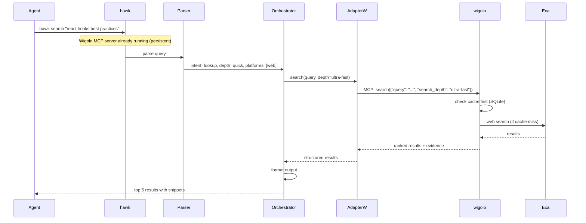
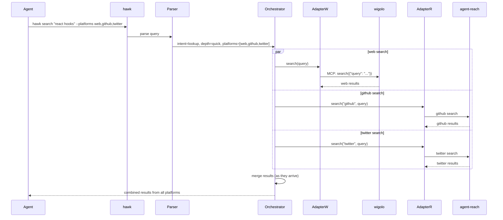
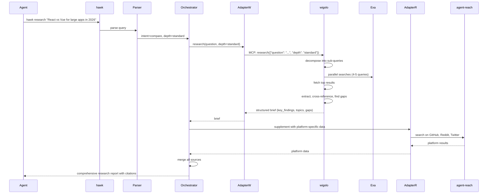
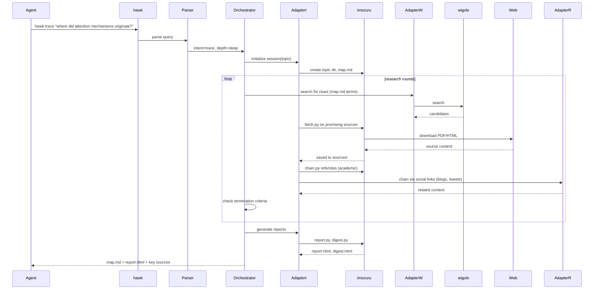

# hawk-search Architecture

## High-Level Flow

```mermaid
graph TD
    Agent[AI Agent] -->|hawk search "query"| Hawk[hawk CLI]
    Agent -->|hawk research "question"| Hawk
    Agent -->|hawk trace "concept"| Hawk

    Hawk --> Parser[Query Parser]
    Parser -->|intent, depth, platforms| Orchestrator[Orchestrator]

    Orchestrator -->|search/fetch/crawl/extract| AdapterW[wigolo MCP Adapter]
    Orchestrator -->|platform search| AdapterR[agent-reach Adapter]
    Orchestrator -->|deep tracing| AdapterI[imozuru Adapter]

    AdapterW -->|MCP protocol| Wigolo[wigolo MCP Server<br/>running locally]
    AdapterR -->|subprocess| AR[agent-reach CLI]
    AdapterI -->|subprocess| IM[imozuru scripts]

    Wigolo --> Web[(Web)]
    AR -->|OpenCLI/API| Social[(Social Platforms)]
    AR -->|gh CLI| GitHub[(GitHub)]
    AR -->|yt-dlp| YouTube[(YouTube)]
    IM -->|fetch.py| Web
    IM -->|chain.py| OpenAlex[(OpenAlex API)]
    IM -->|watch.py| RSS[(RSS Feeds)]
```

## Quick Search Path



**Latency:** Cache hit = ≤50ms (no network). Cache miss = depends on search engine (typically 100-500ms).

## Multi-Platform Fan-Out Path

When searching across multiple platforms, all searches run in parallel:



**Latency:** Takes the time of the slowest platform, not the sum of all three.

## Multi-Source Research Path



## Deep Tracing Path (imozuru-style)



## Pluggable Backend Architecture

hawk abstracts away *which* tool does *what*. Each tool exposes capabilities;
hawk's orchestrator picks the right tool for each sub-task based on capability
matching and user configuration.

```mermaid
graph LR
    subgraph Hawk[hawk CLI (Python)]
        Orch[Orchestrator]
        subgraph Backend Registry
            SR[Search Backends]
            FR[Fetch Backends]
            TR[Trace Backends]
            WR[Watch Backends]
            ER[Extract Backends]
        end
    end

    subgraph Search Backends
        Wigo[wigolo search<br/>ML-rerank, cache-first]
        Exa[Exa AI<br/>via agent-reach or direct]
        DDG[DuckDuckGo<br/>via tab or API]
    end

    subgraph Fetch Backends
        WigoF[wigolo fetch<br/>JS render, auth]
        Jina[Jina Reader<br/>via agent-reach]
        ImozF[imozuru fetch.py<br/>PDF, OCR, YouTube]
    end

    subgraph Trace Backends
        OpenA[OpenAlex<br/>via imozuru chain.py]
        SocialT[Social Graph<br/>via agent-reach]
        LinkT[Link Graph<br/>via wigolo crawl]
    end

    SR --> Wigo
    SR --> Exa
    SR --> DDG
    FR --> WigoF
    FR --> Jina
    FR --> ImozF
    TR --> OpenA
    TR --> SocialT
    TR --> LinkT
```

## Backend Configuration

Users configure which backends hawk uses via `~/.hawk/config.yaml`:

```yaml
# Search backend priority (first available wins)
search:
  default: wigolo          # wigolo | exa | duckduckgo
  platforms:
    web: [wigolo, exa]
    github: [agent-reach]
    youtube: [agent-reach]
    academic: [wigolo, openalex]

# Fetch backend priority
fetch:
  default: wigolo
  pdf: imozuru              # imozuru has better PDF handling (OCR, layout)
  js_heavy: wigolo          # wigolo has browser rendering

# Trace backends
trace:
  academic: openalex        # via imozuru chain.py
  social: agent-reach       # for blog/tweet chains
  web: wigolo               # for link graph

# Tool connection settings
wigolo:
  binary: "wigolo"          # path to wigolo binary or "auto"
  mode: "persistent"        # persistent (default) or "spawn-per-call"
agent_reach:
  binary: "agent-reach"
imo_zuru:
  scripts_dir: "~/.agents/skills/imozuru/scripts"
```

Orchestrator decision logic:

```python
# Pseudocode for backend selection
def pick_search_backend(query, platform):
    priority = config.search.platforms.get(platform, config.search.default)
    for backend_name in priority:
        if is_available(backend_name):
            return get_backend(backend_name)
    raise BackendUnavailable()

# During research, different backends for different sub-queries
sub_queries = decompose(question)
for sq in sub_queries:
    if sq.type == "code":
        results = search_backends["github"].search(sq.query)
    elif sq.type == "discussion":
        results = search_backends["reddit"].search(sq.query)
    else:
        results = search_backends["web"].search(sq.query)
```

```bash
# Quick lookup
hawk search "react version"
hawk search "react hooks" --platforms web,github
hawk search "latest AI news" --depth quick --platforms web,twitter

# Multi-source research
hawk research "best state management for React 2026"
hawk research "PostgreSQL vs SQLite for mobile" --depth comprehensive
hawk research "Rust vs Go for web servers" --platforms web,github,reddit

# Deep tracing (imozuru-style)
hawk trace "attention mechanism origins"
hawk trace "btrfs filesystem design decisions" --rounds 3
hawk trace "who first proposed transformers" --output map,report

# Watch pages
hawk watch add "https://react.dev/blog" --interval 3600
hawk watch list
hawk watch check
hawk watch remove <id>

# Manage research sessions
hawk sessions list
hawk sessions show <id>
hawk sessions export <id> --format markdown
```
