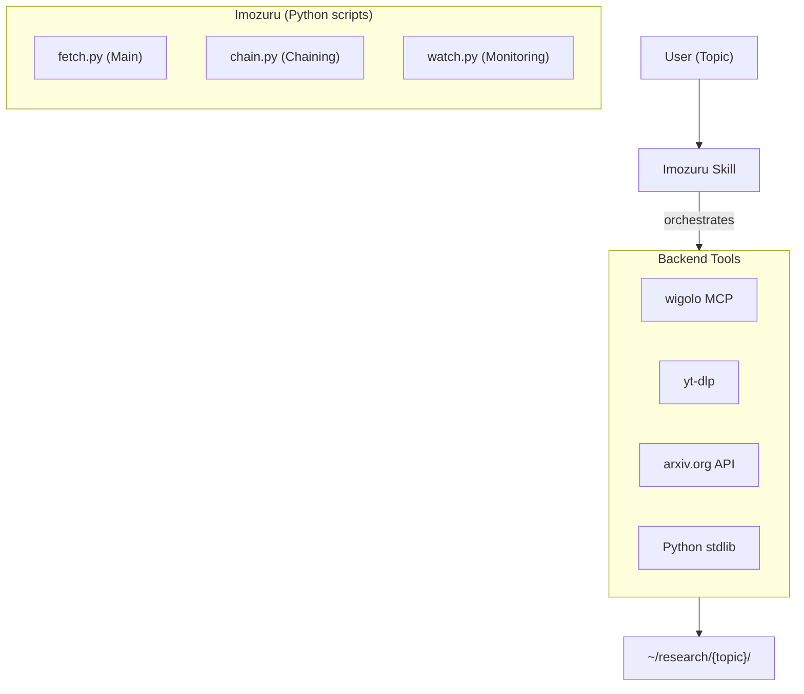

# Imozuru アーキテクチャ

> 対象: imozuru（imozuru-skill）
> 調査日: 2026-07-09
> インストール先: `/Users/atosh/.agents/skills/imozuru/`

## 概要

Imozuru（芋づる式キャッチアップ）は、**知らない分野のキャッチアップを自動化するリサーチスキル**です。分野名やテーマを渡すと、その界隈の用語・中心の人・主要な媒体（学会・雑誌・個人ブログ・動画・リポジトリ・一覧）を自動で特定し、引用・リンク・著者を「芋づる式」にたどって、目当ての原文（論文・個人の記事・動画の字幕）を要約せずそのままローカルに保存します。

### 設計哲学: メタツールとしての外部ツール編成

Imozuru は独自の HTTP/解析ロジックを実装していません。代わりに、以下の外部ツールを編成してリサーチワークフローを駆動する「メタツール」です：

- **wigolo** - Web 検索・取得・抽出・キャッシュ
- **yt-dlp** - YouTube 動画の字幕/トランスクリプト取得
- **arxiv.org** - 論文のメタデータ取得
- **標準ライブラリのみ** - urllib, json, html.parser, feedparser, 等



## 技術スタック

### コア
- **Python 3** - スクリプトはすべて Python
- **標準ライブラリのみ** - urllib, json, html.parser, xml.etree, datetime, hashlib, os, sys, re, collections, shutil, subprocess, urllib.request, urllib.error, urllib.parse, ssl, http.cookiejar, concurrent.futures

### 外部依存
| ツール | 用途 |
|--------|------|
| **wigolo** | Web 検索、URL取得、コンテンツ抽出、類似コンテンツ発見、サイトクロール |
| **yt-dlp** | YouTube 動画のトランスクリプト/字幕取得 |
| **arxiv.org** | 論文のメタデータ・PDF取得 |

### 任意依存
- **feedparser** - RSS フィードの解析（`watch.py` で使用）

## スクリプト構成

imozuru は3つのPythonスクリプトから構成されます：

| スクリプト | サイズ | 役割 |
|-----------|--------|------|
| `scripts/fetch.py` | 125KB | メインリサーチャ（5分間の自動キャッチアップ） |
| `scripts/chain.py` | 34KB |  Citation チェーニング（引用をたどる） |
| `scripts/watch.py` | 31KB | RSS 監視（新着チェック） |

## fetch.py - メインリサーチャ

### 概要
分野名を渡すと5分間でその界隈をキャッチアップするメインスクリプトです。

### ワークフロー
```
seed terms → wigolo search → extract top results → find_similar → crawl domains
    → save originals → update map.md → check saturation → repeat within time budget
```

### 主要コンポーネント

#### 1. wigolo インターフェース（`wigolo()` 関数）
```python
def wigolo(tool: str, **kwargs) -> dict:
    """Call a wigolo tool and return the result."""
    cmd = ["wigolo", tool]
    # Add arguments...
    result = subprocess.run(cmd, capture_output=True, text=True)
    return json.loads(result.stdout)
```

#### 2. 検索ロジック
```python
def search_and_collect(topic: str, seed_terms: list, max_queries: int = 10) -> list:
    """Search for sources using wigolo."""
    results = []
    for term in seed_terms[:max_queries]:
        r = wigolo("search", query=f"{topic} {term}", max_results=10)
        for item in r.get("results", []):
            results.append(item)
    return results
```

#### 3. コンテンツ抽出
```python
def extract_content(url: str) -> dict:
    """Extract content from a URL using wigolo."""
    return wigolo("extract", url=url)
```

#### 4. 類似コンテンツ発見
```python
def find_similar(seed_url: str, topic: str) -> list:
    """Find similar content using wigolo."""
    return wigolo("find_similar", url=seed_url, topic=topic, max_results=5)
```

#### 5. ドメインクロール
```python
def crawl_domain(url: str, topic: str, max_pages: int = 5) -> list:
    """Crawl a domain using wigolo."""
    return wigolo("crawl", url=url, strategy="sitemap", max_pages=max_pages)
```

#### 6. 原文保存
```python
def save_original(url: str, title: str, topic_dir: Path) -> str:
    """Download and save original source."""
    # PDF: wget -O
    # HTML: wget -O
    # Video: yt-dlp --write-auto-subs
    # arXiv: wget PDF
    pass
```

#### 7. マップ管理（`map.md`）
```python
class KnowledgeMap:
    def __init__(self, path: Path):
        self.path = path
        self.terms = {}
        self.people = {}
        self.media = {}
        self.sources = {}
    
    def add_term(self, term: str, description: str):
        self.terms[term] = description
    
    def add_person(self, name: str, role: str, links: list):
        self.people[name] = {"role": role, "links": links}
    
    def add_media(self, name: str, type: str, url: str):
        self.media[name] = {"type": type, "url": url}
    
    def save(self):
        # Write to map.md
        pass
```

#### 8. ソースカタログ（`sources.jsonl`）
```python
class SourceCatalog:
    def __init__(self, path: Path):
        self.path = path
        self.sources = []
    
    def add(self, url: str, title: str, author: str, date: str, 
            source_type: str, local_path: str, status: str):
        entry = {
            "url": url,
            "title": title,
            "author": author,
            "date": date,
            "type": source_type,
            "local_path": local_path,
            "status": status,
            "added_at": datetime.now().isoformat()
        }
        self.sources.append(entry)
        # Append to JSONL
        pass
```

#### 9. 飽和検出
```python
def is_saturated(map: KnowledgeMap, catalog: SourceCatalog, topic: str) -> bool:
    """Check if all aspects of the topic have source coverage."""
    # Check if key terms have associated sources
    # Check if media outlets are covered
    # Check if key people are identified
    pass
```

#### 10. クエリ予算管理
```python
class QueryBudget:
    def __init__(self, max_queries: int = 20, max_minutes: float = 5.0):
        self.max_queries = max_queries
        self.max_seconds = max_minutes * 60
        self.queries_made = 0
        self.start_time = time.time()
    
    def can_query(self) -> bool:
        elapsed = time.time() - self.start_time
        return self.queries_made < self.max_queries and elapsed < self.max_seconds
    
    def record_query(self):
        self.queries_made += 1
```

## chain.py - Citation チェーニング

### 概要
1つの文書から始めて、その引用先をたどり、関連する原文を収集します。

### ワークフロー
```
seed document → extract citations/links → fetch each → extract their citations
    → repeat for N rounds or until saturation
```

### 主要機能
- **引用抽出**: HTML/PDF から URL と参考文献を抽出
- **再帰的フェッチ**: 各引用先を取得し、その引用先もたどる
- **深度制限**: 無限ループを防止するための最大深度

## watch.py - RSS 監視

### 概要
`map.md` に登録された媒体の RSS フィードを定期チェックし、新着原文を収集します。

### ワークフロー
```
read map.md → for each media outlet: check RSS feed → download new items
    → update sources.jsonl → generate digest.html
```

### 主要機能
- **RSS フィード検出**: 媒体名から RSS URL を推定
- **新着判定**: 以前に取得したアイテムとの比較
- **ダイジェスト生成**: `digest.html` に新着アイテムをカード形式で表示

## 出力ディレクトリ構造

```
~/research/{topic}/
├── map.md              # 用語・人・媒体・原文の一覧（週ごとに更新）
├── sources/            # 原文の保存先
│   ├── 001_paper_title.pdf
│   ├── 002_blog_post.html
│   ├── 003_video_transcript.srt
│   └── ...
├── sources.jsonl       # ソースカタログ（1行=1エントリ）
├── report.md           # リサーチレポート
├── report.html         # レンダリングされたレポート
├── digest.html         # 新着ダイジェスト
├── queries.jsonl       # クエリログ
└── fetch-log.jsonl     # 実行ログ
```

## 実行モード

### モード1: 初回キャッチアップ
```bash
python scripts/fetch.py "LLM agents"
```
- 5分間で分野のキャッチアップ
- map.md, sources/, report.md を生成

### モード2: 引用チェーニング
```bash
python scripts/chain.py ~/research/llm-agents/sources/001_paper.pdf
```
- 1つの文書から引用をたどって関連原文を収集

### モード3: RSS 監視
```bash
python scripts/watch.py ~/research/llm-agents
```
- 登録媒体の新着をチェックし、原文を収集

## 飽和判定ロジック

Imozuru は「調査の論点の全部に原文が付くか」をチェックして停止判定を行います：

1. **用語カバレッジ**: 主要な専門用語がすべて map.md に記載されているか
2. **人物カバレッジ**: 界隈の中心人物が特定されているか
3. **媒体カバレッジ**: 主要な情報源（学会・雑誌・ブログ・動画・リポジトリ）が網羅されているか
4. **原文カバレッジ**: 各論点に関連する原文が sources/ に保存されているか

## タイムバジェット管理

- **デフォルト**: 5分間（300秒）
- **クエリ制限**: 最大20回の wigolo クエリ
- **戦略**: 時間内にできる限り多くの search → extract → find_similar → crawl のサイクルを実行

## Imozuru vs agent-reach vs wigolo

| 観点 | imozuru | agent-reach | wigolo |
|------|---------|-------------|--------|
| **種類** | リサーチスキル（Pythonスクリプト） | インストーラー＋ルーター | 統合MCPサーバー |
| **役割** | 分野キャッチアップの自動化 | プラットフォームツールへのアクセス | Webコンテンツの取得・処理 |
| **バックエンド** | wigolo + yt-dlp + arxiv | 上流ツール（OpenCLI, yt-dlp, gh, 等） | 内部パイプライン |
| **出力** | ~/research/{topic}/ ディレクトリ | ツールの直接呼び出し | JSON/MCPレスポンス |
| **時間** | 5分間の自動実行 | 手動呼び出し | リクエストベース |
| **特徴** | 芋づる式キャッチアップ、飽和判定 | 15プラットフォーム対応 | ローカルファースト、キャッシュ |

## まとめ

Imozuru は、**「知らない分野のキャッチアップ」を5分間で自動化するメタツール**です。

主要な特徴：
- **外部ツール編成**: wigolo（Web）、yt-dlp（動画）、arxiv（論文）を統合
- **芋づる式探索**: 用語→人→媒体→原文の連鎖を自動でたどる
- **原文保存**: 要約ではなく原文をそのままローカルに保存
- **飽和判定**: 「論点の全部に原文が付くか」をチェックして停止
- **時間バジェット**: 5分間でできる限りのキャッチアップを実行
- **3つのモード**: 初回キャッチアップ、引用チェーニング、RSS監視

agent-reach や wigolo とは補完的な関係で、imozuru は「リサーチワークフローの自動化」、agent-reach は「ツールへのアクセス」、wigolo は「コンテンツの取得・処理」をそれぞれ得意としています。
