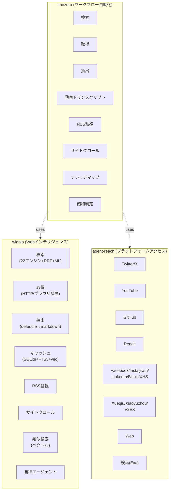

# ツール統合戦略: wigolo + agent-reach + imozuru

> 対象: wigolo v0.3.1, agent-reach v1.5.0, imozuru
> 作成日: 2026-07-09

## 前提: 各ツールの役割

| ツール | 本質 | 得意分野 |
|--------|------|----------|
| **wigolo** | ローカルファーストWebインテリジェンスMCPサーバー | 検索・取得・抽出・キャッシュ・監視 |
| **agent-reach** | インターネットアクセス能力ルーター | 15プラットフォームへのツールアクセス |
| **imozuru** | 分野キャッチアップ自動化スキル | 5分間の芋づる式リサーチワークフロー |

## 重複・補完関係の分析



### 重複箇所

| 機能 | imozuru | wigolo | agent-reach | 推奨担当 |
|------|---------|--------|-------------|----------|
| Web検索 | ✅ (wigolo経由) | ✅ (独自22エンジン) | ✅ (Exa API) | **wigolo** |
| Web取得 | ✅ (wigolo経由) | ✅ (独自パイプライン) | ✅ (fetch/curl) | **wigolo** |
| コンテンツ抽出 | ✅ (wigolo経由) | ✅ (defuddle等) | ❌ | **wigolo** |
| YouTubeトランスクリプト | ✅ (yt-dlp直接) | ❌ | ✅ (yt-dlp) | **agent-reach** |
| GitHub | ✅ (wigolo経由) | ✅ (HTTP) | ✅ (gh CLI) | **agent-reach** |
| Reddit | ✅ (wigolo経由) | ✅ (HTTP) | ✅ (reddit-cli) | **agent-reach** |
| RSS監視 | ✅ (独自実装) | ✅ (watch) | ❌ | **wigolo** |
| サイトクロール | ✅ (wigolo経由) | ✅ (独自) | ❌ | **wigolo** |
| Twitter/X | ❌ | ✅ (HTTP) | ✅ (OpenCLI) | **agent-reach** |
| 認証付きサイト | ❌ | ✅ (ブラウザ) | ✅ (Cookie) | **agent-reach** |
| 類似コンテンツ検索 | ❌ | ✅ (sqlite-vec) | ❌ | **wigolo** |
| 自律リサーチ | ❌ | ✅ (agent) | ❌ | **wigolo** |
| ナレッジマップ | ✅ (独自) | ❌ | ❌ | **imozuru** |
| 飽和判定 | ✅ (独自) | ❌ | ❌ | **imozuru** |
| Citationチェーニング | ✅ (独自) | ❌ | ❌ | **imozuru** |

## 統合戦略: レイヤードアーキテクチャ

### 基本的なレイヤ構造

```
┌─────────────────────────────────────────────────────────┐
│  AI Agent (Claude, etc.)                                │
└───────────────────────────┬─────────────────────────────┘
                            │
┌───────────────────────────▼─────────────────────────────┐
│  imozuru (Research Workflow Automation)                 │
│  - ワークフロー制御                                      │
│  - ナレッジマップ管理                                    │
│  - 飽和判定・クエリ予算管理                              │
│  - Citation チェーニング                                 │
└───────────┬───────────────────────────┬─────────────────┘
            │                           │
┌───────────▼─────────────┐ ┌───────────▼─────────────────┐
│  wigolo                 │ │  agent-reach                │
│  (Web Intelligence)     │ │  (Platform Access)          │
│  - 検索 (22エンジン)     │ │  - Twitter/X                │
│  - 取得 (HTTP/ブラウザ)  │ │  - YouTube                  │
│  - 抽出 (markdown化)     │ │  - GitHub                   │
│  - キャッシュ            │ │  - Reddit                   │
│  - 類似検索              │ │  - 中国系プラットフォーム     │
│  - RSS監視               │ │  - 認証付きサイト           │
│  - 自律エージェント       │ │  - ツール設定管理           │
└─────────────────────────┘ └─────────────────────────────┘
```

### 統合ルール

**ルール1: 一般Webコンテンツはwigolo経由**
- 通常のWebページの検索・取得・抽出はすべてwigolo
- キャッシュ・抗ボット・コンテンツ抽出の恩恵を受ける

**ルール2: プラットフォームコンテンツはagent-reach経由**
- Twitter/X, YouTube, GitHub, Reddit, Facebook, Instagram, LinkedIn, Bilibili, Xiaohongshu, Xueqiu, Xiaoyuzhou, V2EX はagent-reachのツール
- 認証・ログインが必要なものもagent-reach

**ルール3: imozuruはオーケストレーター**
- imozuruは直接HTTPリクエストやツール呼び出しをしない
- wigolo（MCP）とagent-reach（CLI）を呼び出すだけ
- ワークフロー制御・ナレッジ管理・飽和判定に専念

## 具体的な統合実装案

### imozuruの改造点

#### 1. YouTubeトランスクリプト取得
```python
# Before: yt-dlpを直接呼び出し
def get_youtube_transcript(url):
    return subprocess.run(["yt-dlp", "--write-auto-subs", url])

# After: agent-reachを参照してツールを呼び出し
def get_youtube_transcript(url):
    # agent-reach list からyoutubeのコマンドを取得
    ar_info = agent_reach_list("youtube")
    cmd = ar_info["command"].format(url=url)
    return subprocess.run(cmd)
```

#### 2. GitHubリポジトリの取得
```python
# Before: wigolo経由でHTTP取得
def get_github_repo(owner, repo):
    return wigolo("fetch", url=f"https://github.com/{owner}/{repo}")

# After: agent-reachのgh CLIを使用
def get_github_repo(owner, repo):
    ar_info = agent_reach_list("github")
    cmd = f"{ar_info['command']} repo view {owner}/{repo}"
    return subprocess.run(cmd)
```

#### 3. Twitter/Xの検索
```python
# Before: wigolo経由でHTTP取得（制限あり）
def search_twitter(query):
    return wigolo("search", query=f"site:twitter.com {query}")

# After: agent-reachのtwitter-cliを使用
def search_twitter(query):
    ar_info = agent_reach_list("twitter")
    cmd = f"{ar_info['command']} search \"{query}\" --limit 10"
    return subprocess.run(cmd)
```

### agent-reachの追加機能案

#### MCPサーバー経由のツール呼び出し
```python
# agent-reachにMCPサーバーを追加（既存のmcp_server.pyを拡張）
# imozuruがMCP経由でagent-reachのツールを呼び出せるようにする

@mcptool
def execute_platform_tool(platform: str, command: str, **kwargs) -> dict:
    """Execute a platform tool via agent-reach."""
    # Validate platform and command
    # Execute the appropriate tool
    # Return structured result
    pass
```

### wigoloの拡張機能案

#### プラットフォームリダイレクト
```python
# wigoloがプラットフォームURLを検出し、agent-reachにリダイレクト
def fetch(url: str, **kwargs):
    if is_platform_url(url):
        platform = detect_platform(url)
        # Call agent-reach MCP tool
        return call_agent_reach(platform, url)
    else:
        # Use wigolo's own pipeline
        return normal_fetch(url, **kwargs)
```

## 代替 vs 追加の判断基準

### 代替すべき場合（機能の重複）
1. **より高い品質を提供するツールがある場合**
   - YouTubeトランスクリプト: agent-reach (yt-dlp) > imozuruの直接呼び出し
   - 理由: agent-reachは設定・エラー処理・バージョン管理を提供

2. **認証が必要な場合**
   - Twitter/X, Facebook, Instagram: agent-reach (OpenCLI+Cookie) > wigolo (HTTP)
   - 理由: wigoloは一般Web向け、ログイン付きアクセスはagent-reachの専門

3. **専用ツールが存在する場合**
   - GitHub: agent-reach (gh CLI) > wigolo (HTTP)
   - 理由: gh CLIはAPI制限・レートリミット・認証を適切に処理

### 追加すべき場合（機能の補完）
1. **ローカルキャッシュと検索が必要**
   - wigoloのキャッシュ+FTS5検索は他にない
   - imozuruの取得結果をwigoloにキャッシュさせる

2. **コンテンツの構造化処理が必要**
   - wigoloの抽出パイプライン（defuddle→readability→turndown→sanitize）
   - agent-reachはraw dataを返すだけ

3. **ワークフロー自動化が必要**
   - imozuruの飽和判定・ナレッジマップ・Citationチェーニング
   - wigolo/agent-reachにはない高次なリサーチ制御

## 具体的な統合シナリオ

### シナリオ1: 新分野のキャッチアップ
```
User: "LLM agentsの分野をキャッチアップして"
    ↓
imozuru:
    1. wigolo.search("LLM agents survey") → 学術論文・レビュー記事を取得
    2. wigolo.search("LLM agents tutorial") → 入門記事を取得
    3. wigolo.find_similar(重要な論文URL) → 関連論文を芋づる式に発見
    4. agent-reach (YouTube): "LLM agents explained" の動画トランスクリプト取得
    5. agent-reach (Twitter/X): LLM agents関連の最新議論を取得
    6. agent-reach (GitHub): 人気リポジトリを特定・クローニング
    7. wigolo.crawl(学会サイト) → 会議プログラムからセッションを特定
    8. 飽和判定 → 全論点に原文が付いたら停止
    9. map.md + sources/ + report.md を生成
```

### シナリオ2: 特定トピックの最新動向
```
User: "LLM agentsの今週の新着を教えて"
    ↓
imozuru (watch mode):
    1. map.mdから登録媒体を読み込み
    2. wigolo.watch (または独自RSSチェック) → 各媒体の新着を取得
    3. agent-reach (Twitter/X): キーワードの最新ツイートを取得
    4. agent-reach (GitHub): 注目リポジトリの最新release/PRを取得
    5. 新着原文を ~/research/{topic}/sources/ に保存
    6. digest.html を生成
```

### シナリオ3: 論文のCitationネットワーク探索
```
User: "この論文の引用ネットワークをたどって"
    ↓
imozuru (chain mode):
    1. chain.py: 論文から引用URLを抽出
    2. 各URLに対して:
        - arXiv → wigolo.fetch + PDF取得
        - 一般Web → wigolo.fetch + コンテンツ抽出
        - YouTube動画 → agent-reach (YouTube) でトランスクリプト取得
        - GitHubリポジトリ → agent-reach (GitHub) で取得
    3. 深度Nまで再帰的にたどる
    4. 各原文を sources/ に保存
```

## 実装ロードマップ

### Phase 1: imozuruのバックエンド切り替え（短期）
- [ ] imozuruのYouTube取得をagent-reach経由に変更
- [ ] imozuruのGitHub取得をagent-reach経由に変更
- [ ] imozuruのTwitter/X取得をagent-reach経由に変更
- [ ] imozuruの一般Web取得をwigolo経由に統一（既存の通り）

### Phase 2: agent-reachのMCP拡張（中期）
- [ ] agent-reachにMCPサーバー機能を追加（既存のmcp_server.pyを拡張）
- [ ] `execute_platform_tool(platform, command)` MCPツールを提供
- [ ] imozuruからMCP経由でagent-reachを呼び出せるようにする

### Phase 3: wigoloのプラットフォームリダイレクト（中期）
- [ ] wigoloがプラットフォームURLを検出しagent-reachにリダイレクト
- [ ] `is_platform_url()` 関数の実装
- [ ] agent-reach MCPとの連携

### Phase 4: 統合テストと最適化（長期）
- [ ] 3ツールの統合テストスイート
- [ ] エラー処理とフォールバック戦略
- [ ] パフォーマンス最適化（並列処理・キャッシュ活用）

## リスクと対策

| リスク | 対策 |
|--------|------|
| agent-reachのツールが未インストール | imozuruが `agent-reach doctor` で確認し、インストールを案内 |
| wigoloのキャッシュが古い | TTL管理 + `wigolo watch` による変更検知 |
| プラットフォームのAPI変更 | agent-reachのツール更新で対応（imozuruは影響なし） |
| 依存関係の複雑化 | 明確なレイヤ境界の維持 + ドキュメント化 |

## まとめ

3ツールの最適な組み合わせは**レイヤードアーキテクチャ**です：

1. **imozuru**（最上層）: リサーチワークフローのオーケストレーター
2. **wigolo**（中層）: 一般Webのインテリジェンス（検索・取得・抽出・キャッシュ）
3. **agent-reach**（中層）: プラットフォームへのアクセス（認証付き・専用ツール）

### 代替の原則
- **プラットフォームコンテンツ**（Twitter, YouTube, GitHub, 等）→ agent-reachが担当
- **一般Webコンテンツ** → wigoloが担当
- imozuruはどちらのrawデータも直接扱わず、オーケストレーションに専念

### 追加の原則
- **wigoloに追加**: プラットフォームURLのリダイレクト機能
- **agent-reachに追加**: MCPサーバー経由のツール呼び出し
- **imozuruは追加なし**: 既存のワークフロー制御機能に専念

この統合により、AIエージェントは「LLM agentsの分野をキャッチアップして」のように自然言語で指示するだけで、学術論文・ブログ・動画・ソーシャルメディア・GitHubリポジトリのすべてを網羅的なキャッチアップできるようになります。
