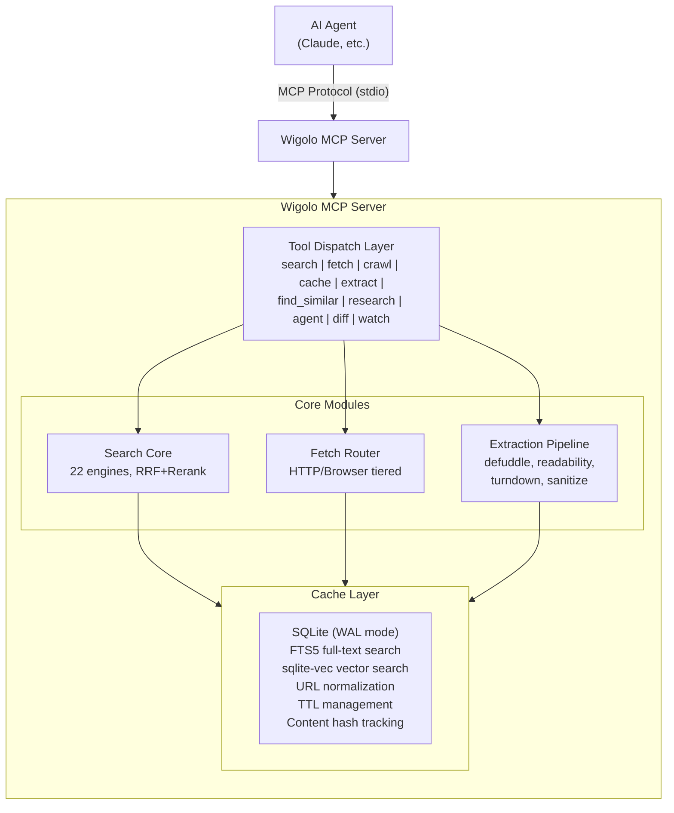
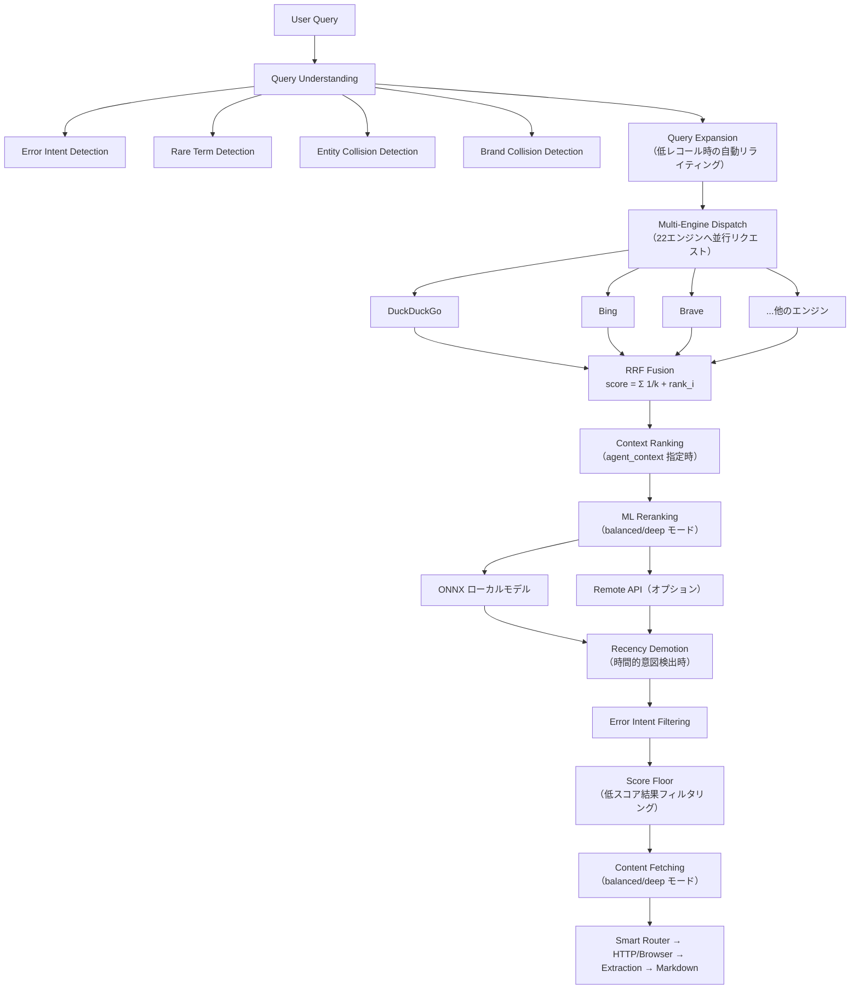
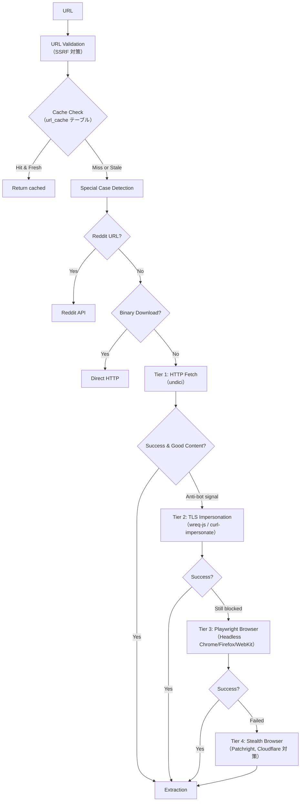
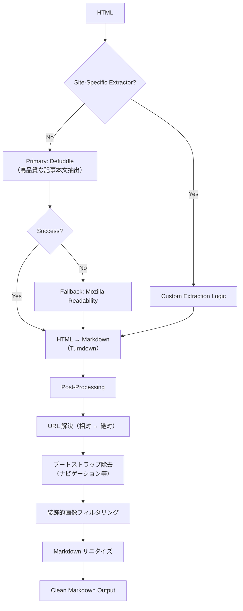

# Wigolo アーキテクチャ詳細

> 調査日: 2025-01-13
> バージョン: 0.3.1 (npm: `wigolo`)
> リポジトリ: https://github.com/KnockOutEZ/wigolo

## 概要

Wigolo は **ローカルファーストのウェブインテリジェンス MCP サーバ** です。AI エージェント向けに、ウェブ検索、ページ取得、クロール、データ抽出、類似コンテンツ発見、深層リサーチ、データ収集、ページ変更の監視・差分比較を提供します。

**主要な特徴:**
- API キー不要（オプションで外部サービス接続可）
- クラウド往復なし（全てローカル実行）
- ML リランク（ローカル ONNX モデル）
- 永続化されたナレッジキャッシュ（SQLite + 全文検索 + ベクトル検索）
- 透明性と監査可能性を備えたスコアリング

## 全体アーキテクチャ

 ```mermaid
   architecture
       subgraph agent[AI Agent]
           service claude:Claude["Claude, etc."]
       end
       subgraph wigolo[Wigolo MCP Server]
           service tools:Tools["Tool Dispatch"]
           service search:Search["Search Core"]
           service fetch:Fetch["Fetch Router"]
           service extract:Extract["Extraction Pipeline"]
           service cache:Cache["SQLite Cache"]
       end
       claude:R --> tools:L
       tools:R --> search:L
       tools:R --> fetch:L
       tools:R --> extract:L
       search:R --> cache:L
       fetch:R --> cache:L
       extract:R --> cache:L
 ```



## 技術スタック

### コアランタイム
- **TypeScript** → JavaScript (tsup/esbuild でコンパイル)
- **Node.js >= 22**
- **ES Modules**

### データベース
- **better-sqlite3**: SQLite3 への高速バインディング
- **sqlite-vec**: SQLite のベクトル検索拡張（ANN 検索）
- **FTS5**: SQLite 内蔵の全文検索エンジン

### 検索バックエンド
- **22 内蔵検索エンジン**（スクレイピング型）:
  - 一般: DuckDuckGo, Bing, Brave, Mojeek, Marginalia
  - ニュース: Bing News
  - 画像: Brave Image, DuckDuckGo Image
  - 学術: arXiv, DBLP, Semantic Scholar, OpenReview, OpenAlex
  - コード: GitHub Code, Stack Overflow, crates.io, DevDocs, MDN
  - ソーシャル: Hacker News (Algolia), Lobsters
  - エンサイクロペディア: Wikipedia
- **SearXNG**（オプション）: プライバシー重視のメタ検索エンジン（ローカル/外部/Docker）

### ブラウザ自動化
- **Playwright**: 主要ブラウザ自動化作業
- **Patchright**（オプション）: ステルスブラウザドライバ（Cloudflare チallenge 対策）
- **chrome-remote-interface**（オプション）: CDP 直接接続
- **wreq-js**（オプション）: TLS フィンガープリント偽装

### ML / AI
- **@huggingface/transformers**: ローカル ONNX モデル実行
- **fastembed**: 高速ローカル埋め込み生成
- **Reranker**: `Xenova/ms-marco-MiniLM-L-6-v2`（ONNX）
- **外部 AI**（オプション）: OpenAI, Anthropic, Google Gemini, Groq SDKs

### 内容抽出
- **defuddle**: 高品質な記事本文抽出（主要）
- **@mozilla/readability**: Mozilla Readability（フォールバック）
- **turndown**: HTML → Markdown 変換
- **linkedom**: 高速 DOM パーサ（ブラウザ不要）
- **tinyld**: 軽量な DOM 処理

### HTTP クライアント
- **undici**: Node.js 内蔵 HTTP クライアント（高速）

### 他
- **@modelcontextprotocol/sdk**: MCP プロトコル実装
- **@anthropic-ai/sdk, openai, @google/genai, groq-sdk**: 外部 AI API クライアント
- **ink / @inkjs/ui / react**: CLI インタフェース
- **pdf-parse**: PDF 解析
- **sharp**: 画像処理

## データベース設計

### スキーマ

```sql
-- URL キャッシュ（ページの内容）
CREATE TABLE url_cache (
  id INTEGER PRIMARY KEY,
  url TEXT UNIQUE,
  normalized_url TEXT,       -- UTM パラメータ除去、www 除去
  title TEXT,
  markdown TEXT,             -- 抽出された本文（Markdown）
  raw_html TEXT,             -- 生 HTML（オプション）
  metadata TEXT,             -- JSON: description, author, date, etc.
  links TEXT,                -- JSON: 抽出されたリンク
  images TEXT,               -- JSON: 抽出された画像
  fetch_method TEXT,         -- http | playwright | tls | reddit-api
  extractor_used TEXT,       -- defuddle | readability | custom
  content_hash TEXT,         -- SHA-256 of markdown（変更検出用）
  fetched_at TEXT,
  expires_at TEXT,           -- TTL 管理
  embedding BLOB,            -- ベクトル埋め込み
  embedding_model TEXT,      -- 使用モデル名
  embedding_dims INTEGER
);

-- 全文検索インデックス（FTS5）
CREATE VIRTUAL TABLE url_cache_fts USING fts5(
  title, markdown, url,
  content='url_cache',
  content_rowid='id'
);

-- 検索結果キャッシュ
CREATE TABLE search_cache (
  id INTEGER PRIMARY KEY,
  query TEXT,
  query_hash TEXT UNIQUE,    -- SHA-256 of query+params
  results TEXT,              -- JSON: 検索結果
  engines_used TEXT,
  searched_at TEXT,
  expires_at TEXT
);

-- ドメインルーティング（どの方法で取得するか）
CREATE TABLE domain_routing (
  domain TEXT PRIMARY KEY,
  prefer_playwright INTEGER, -- HTTP で失敗したらブラウザを使うか
  http_failures INTEGER,
  last_updated TEXT
);
```

### キャッシュ戦略
- **WAL（Write-Ahead Logging）モード**: 並行読み書きに対応
- **URL 正規化**: UTM パラメータ除去、www 除去、クエリソート
- **TTL 管理**: コンテンツはデフォルトで期限付き
- **内容ハッシュ**: SHA-256 で変更検出（`watch`/`diff` 機能の基盤）
- **ベクトル埋め込み**: `find_similar` 機能の基盤（sqlite-vec で ANN 検索）

## 検索パイプライン（詳細）



### 検索深度モード
| モード | 説明 | 特徴 |
|--------|------|------|
| `ultra-fast` | キャッシュのみ（≤300ms） | キャッシュミスなら即返却 |
| `fast` | 検索のみ（≤1s） | コンテンツ取得なし |
| `balanced` | 検索+リランク+内容取得（デフォルト） | RRF + ML リランク |
| `deep` | 最大深度 | より多くのリソースを消費 |

## 取得パイプライン（Fetch Router）



### Anti-Bot 検出とエスカレーション
- **HTTP ステータス**: 403, 429, 503
- **Challenge Shell 検出**: 空の HTML または JS challenge
- **Anti-bot キーワード**: "Please wait", "Verifying", "JavaScript required"
- **ドメインルーティング**: 失敗回数を追跡し、ブラウザ使用を自動でエスカレート

## 内容抽出パイプライン



## 主要な機能と内部実装

### 1. Search（検索）
- **ファイル**: `dist/search/core/core-provider.js`
- **特徴**:
  - マルチクエリ配列（3-5 件のキーワードバリエーション推奨）
  - ドメインスコーピング（include/exclude）
  - 日時フィルタリング
  - 言語フィルタリング
  - 完全一致モード
  - エビデンススコアリング（`include_evidence: true`）
  - 引用書式（`citation_format: "anthropic_tags"`）
  - Answer 合成モード（`format: "answer"`）

### 2. Fetch（ページ取得）
- **ファイル**: `dist/fetch/router.js`
- **特徴**:
  - 多段フェッチ戦略（HTTP → TLS → Browser → Stealth）
  - SPA 対応（Playwright でレンダリング）
  - 認証済みセッション（`auth: { type: "browser-session" }`）
  - PDF サポート
  - 変更検出（`detect_changes: true`）

### 3. Crawl（サイトクロール）
- **ファイル**: `dist/crawl/`
- **戦略**: sitemap / BFS / DFS / URL-map
- **特徴**:
  - アンカーフラグメントの重複除去
  - レートリミティング
  - robots.txt 遵守
  - ローカルキャッシュへの自動保存

### 4. Cache（キャッシュ管理）
- **ファイル**: `dist/cache/`
- **機能**:
  - キャッシュ検索（FTS5）
  - キャッシュ統計
  - 期限切れエントリのクリア
  - 変更された URL の再チェック

### 5. Extract（構造化データ抽出）
- **ファイル**: `dist/extraction/`
- **抽出対象**:
  - テーブル
  - 定義リスト
  - キーバリューペア
  - JSON-LD
  - マイクロデータ
  - チャートヒント（SVG title, aria-label, figcaption）
  - ブランドアセット
  - メタデータ

### 6. Find Similar（類似コンテンツ発見）
- **ファイル**: `dist/search/find-similar.js`
- **アルゴリズム**: 3-way Reciprocal Rank Fusion
  - ローカルベクトル検索（sqlite-vec）
  - キーワード検索（FTS5）
  - ライブ Web 検索
- **使用シーナリオ**: 良いソースがあり、それに似たものをもっと見つけたい場合

### 7. Research（深層リサーチ）
- **ファイル**: `dist/search/research/`
- **機能**:
  - 質問分解
  - 並列検索
  - 構造化ブリーフ生成
  - クロスリファレンス
  - ギャップ分析

### 8. Agent（自律データ収集）
- **ファイル**: `dist/agent/`
- **機能**:
  - ナチュラル言語プロンプトからの検索クエリ計画
  - JSON Schema による構造化フィールド抽出
  - 時間予算内での並列実行
  - フルステップ透明性

### 9. Diff（変更比較）
- **ファイル**: `dist/cache/diff-engine.js`
- **機能**:
  - セクションレベルのハunk
  - 単語/行レベルの粒度
  - 変更サマリー

### 10. Watch（変更監視）
- **ファイル**: `dist/watch/`
- **機能**:
  - レイジーウォッチジョブ（必要な時にのみチェック）
  - SSRF ガード付き
  - Webhook 通知（オプション）

## 検索バックエンドの選択

```
WIGOLO_SEARCH env var:
  - "core" (デフォルト): 22 内蔵エンジン + RRF + ML リランク
  - "searxng": SearXNG メタ検索エンジン（外部/ローカル/Docker）
  - "hybrid": core + searxng（core が失敗したら searxng にフォールバック）
```

### SearXNG のブートストラップ
Wigolo は SearXNG を自動でインストール・管理できます：
1. 外部 URL（`WIGOLO_SEARXNG_URL`）
2. ネイティブインストール（`wigolo warmup --searxng`）
3. Docker コンテナ

## 埋め込みとベクトル検索

### 埋め込みサービス
- **ファイル**: `dist/embedding/embed.js`
- **プロバイダ**:
  - `fastembed`: ローカル ONNX モデル（`BAAI/bge-small-en-v1.5` など）
  - `openai`: `text-embedding-3-small` / `text-embedding-3-large`
- **バックグラウンドキュー**: 埋め込み生成を非同期で処理

### ベクトルストア
- **ファイル**: `dist/cache/sqlite-vec-store.js`
- **実装**: sqlite-vec 拡張による近似最近傍（ANN）検索
- **用途**: `find_similar` 機能のセマンティック検索

## リランキング

### ONNX ローカルリランカー
- **ファイル**: `dist/search/reranker/transformers-rerank-provider.js`
- **モデル**: `Xenova/ms-marco-MiniLM-L-6-v2`
- **特徴**:
  - ローカル実行（API コールなし）
  - HuggingFace Transformers.js（ONNX バックエンド）
  - 初回使用時にモデルをダウンロード（`wigolo warmup` で事前キャッシュ可）

### リランク戦略
- `balanced` モード: Top-K にリランクを適用
- `deep` モード: より多くの結果にリランクを適用
- `fast` モード: リランクなし（速度優先）

## 設定と構成

### 環境変数（主要なもの）
| 変数 | デフォルト | 説明 |
|------|-----------|------|
| `WIGOLO_SEARCH` | `core` | 検索バックエンド |
| `WIGOLO_DATA_DIR` | `~/.wigolo` | データディレクトリ |
| `WIGOLO_RERANKER` | `onnx` | リランカー（onnx/remote/off） |
| `WIGOLO_EMBEDDINGS` | `off` | 埋め込み（off/fastembed/openai） |
| `WIGOLO_SEARCH_DEPTH` | `balanced` | 検索深度 |
| `WIGOLO_CACHE_TTL` | 86400 | キャッシュTTL（秒） |
| `WIGOLO_SEARXNG_URL` | - | 外部 SearXNG URL |
| `WIGOLO_BROWSER_TYPES` | `chromium` | 使用するブラウザ |
| `WIGOLO_STEALTH` | `off` | ステルスモード |

### 設定の優先順位
1. 環境変数
2. 永続化された設定（`~/.wigolo/config.json`）
3. デフォルト値

## セキュリティ

- **SSRF 対策**: `guardFetchUrl()`, `guardResolvedHost()`
- **DB パーミッション**: 600（所有者のみ）
- **Webhook**: SSRF ガード付き
- **認証情報**: OS Keychain 統合（`@napi-rs/keyring`）

## パフォーマンス最適化

- **並行処理**: 検索エンジンは並行リクエスト
- **ブラウザプール**: 複数ブラウザのラウンドロビン
- **バックグラウンド埋め込み**: 非同期キュー
- **キャッシュファースト**: 常にキャッシュを先にチェック
- **WAL モード**: 並行読み書きの高速化
- **Pre-warm**: `wigolo warmup` でモデル/エンジンの事前ロード

## 拡張性

### プラグインシステム
- **ファイル**: `dist/plugins/`
- **登録可能なコンポーネント**:
  - カスタム検索エンジン
  - カスタム抽出器
  - サイト固有の処理

### MCP ツールの登録
新しい MCP ツールは `dist/tools/` に追加し、`dist/server.js` で登録します。

## セットアップとインストール

### インストール
```bash
npm install -g wigolo
```

### 初期セットアップ（自動）
インストール時に以下のコンポーネントが自動的に準備されます：
- データディレクトリ: `~/.wigolo`
- SQLite データベース（`wigolo.db`）+ FTS5 インデックス
- ベクトル検索拡張（sqlite-vec）のロード
- ブラウザ（Playwright Chromium）のインストール（未インストール時）

### Warmup（事前キャッシュ）
```bash
wigolo warmup            # ML リランカー + 埋め込みモデルを事前ダウンロード
wigolo warmup --searxng  # SearXNG 検索エンジンをインストール
```

### 検索バックエンドの選択
| 変数 | 値 | 説明 |
|------|-----|------|
| `WIGOLO_SEARCH` | `core`（デフォルト） | 22 内蔵エンジン + RRF + ML リランク |
| `WIGOLO_SEARCH` | `searxng` | SearXNG メタ検索エンジン |
| `WIGOLO_SEARCH` | `hybrid` | core + searxng（フォールバック） |

### オプション API キー
以下の環境変数を設定すると、より多くの機能が有効になります：

| 環境変数 | 有効化される機能 |
|----------|-----------------|
| `BRAVE_API_KEY` | Brave 検索・画像検索 |
| `WIGOLO_GITHUB_TOKEN` | GitHub Code 検索 |
| `ANTHROPIC_API_KEY` | LLM による answer 合成・研究（Anthropic） |
| `OPENAI_API_KEY` | LLM による answer 合成・研究（OpenAI） |
| `GEMINI_API_KEY` | LLM による answer 合成・研究（Google） |
| `GROQ_API_KEY` | LLM による answer 合成・研究（Groq） |

**注意**: API キーはすべてオプションです。キーがなくても、ローカル ML モデルと内蔵検索エンジンで完全機能します。

## 診断とヘルスチェック

### `wigolo doctor`
システム全体の健全性を診断します：
```bash
wigolo doctor           # 標準診断
wigolo doctor --json    # JSON 出力（スクリプト用）
wigolo doctor --probe-engines  # 検索エンジンの接続テスト
wigolo doctor --fix     # 自動修正を試みる
```

**診断内容：**
- データディレクトリの書き込み可能か
- Python/Docker の利用可能性
- ブラウザエンジンの状態（Playwright、各ブラウザのインストール状況）
- フェッチティア（TLS 層の有効/無効）
- オプションコンポーネント（ML リランカー、埋め込みモデル）
- LLM API キーの設定状況
- 検索バックエンドと各エンジンのステータス

### `wigolo status`
シンプルなステータス表示：
```bash
wigolo status
```
表示内容：バージョン、検索エンジン、リランカー、埋め込み、キャッシュ統計、接続中のエージェント

### `wigolo health`
ヘルスチェック（スクリプト用）：
```bash
wigolo health
```

### 診断例（動作確認済み環境）
```bash
$ wigolo doctor
[wigolo doctor] Data dir:        /Users/atosh/.wigolo
  Writable:      yes

[wigolo doctor] Runtime:
  Python 3:      available (3.14.7)
  Docker:        not available

[wigolo doctor] Browser engine:
  Installation:  installed (v1.64.1)
  Browsers:      chromium OK  firefox not installed  webkit not installed

[wigolo doctor] Optional components:
  ML reranker:        installed (cross-encoder)
  Embeddings model:   installed (fastembed BGE-small-en-v1.5)

[wigolo doctor] Search backend:
  Backend:       core (default: core)
  Modes:         * core     searxng     hybrid

[wigolo doctor] Search engines:
  duckduckgo      general    ok
  bing            general    ok
  brave           general    disabled (set BRAVE_API_KEY)
  mojeek          general    ok
  marginalia      general    ok
  wikipedia       general    ok
  ...（他のエンジンも同様に確認）
```

## CLI コマンド一覧

| コマンド | 説明 |
|----------|------|
| `wigolo search` | ウェブ検索 |
| `wigolo fetch` | ページ取得 |
| `wigolo crawl` | サイトクロール |
| `wigolo extract` | データ抽出 |
| `wigolo cache` | キャッシュ管理 |
| `wigolo find-similar` | 類似コンテンツ発見 |
| `wigolo research` | 深層リサーチ |
| `wigolo agent` | 自律データ収集 |
| `wigolo diff` | 変更比較 |
| `wigolo watch` | 変更監視 |
| `wigolo warmup` | 事前キャッシュ（モデル/エンジン） |
| `wigolo serve` | デーモンモード |
| `wigolo health` | ヘルスチェック |
| `wigolo doctor` | 診断ツール |
| `wigolo mcp` | MCP サーバ起動 |
| `wigolo init` | 初期設定 |
| `wigolo config` | 設定管理 |
| `wigolo status` | ステータス表示 |
| `wigolo setup` | MCP 設定 |
| `wigolo skills` | スキル管理 |

## まとめ

Wigolo は「ローカルファースト」を徹底した設計で、以下のレイヤーを組み合わせることで、AI エージェントに高品質なウェブインテリジェンスを提供しています：

1. **多様な検索ソース**（22 エンジン + SearXNG オプション）
2. **洗練されたランク融合**（RRF + ML リランク）
3. **堅牢なフェッチ戦略**（HTTP → TLS → Browser → Stealth の多段エスカレーション）
4. **高品質な内容抽出**（Defuddle + Mozilla Readability + 後処理）
5. **永続化ナレッジキャッシュ**（SQLite + FTS5 + ベクトル検索）
6. **自律的なデータ収集**（Research / Agent モード）

この設計により、API キー不要でプライバシーを重視し、かつ高品質な検索・取得・分析を実現しています。
